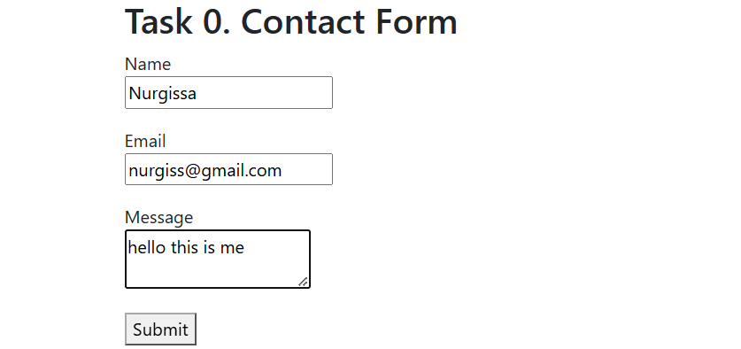
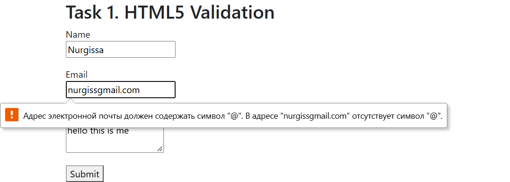
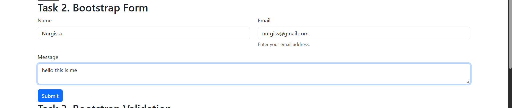
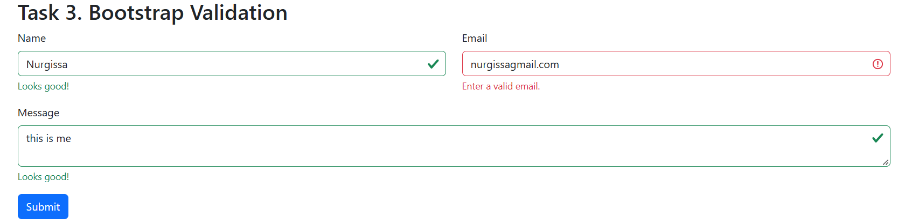
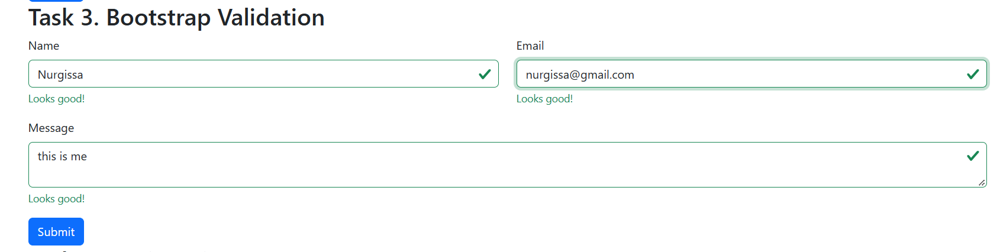
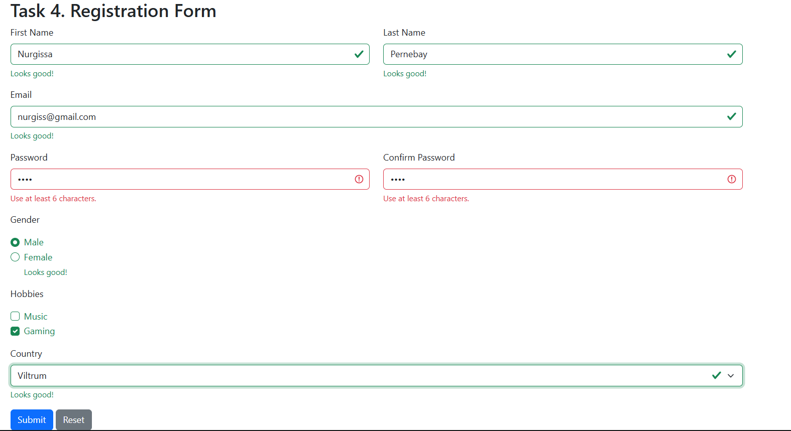
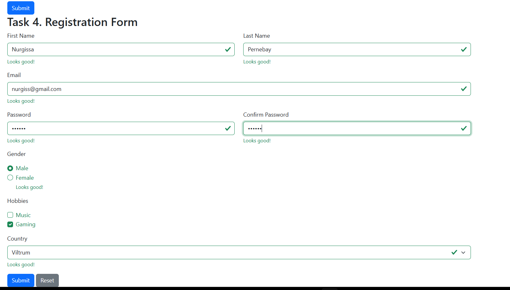

# Assignment 4. Forms and Validation
**Name:** Nurgissa Pernebay  
**Group:** SE-2539
## Part 1. Basic HTML Forms
### Task 0. Simple Contact Form
Created a contact form with Name, Email, Message, and Submit.

### Task 1. Form with HTML5 Validation
Added HTML5 validation using `required`, `type="email"`, and `maxlength`.

## Part 2. Bootstrap Forms
### Task 2. Bootstrap Form Styling
Styled the contact form using Bootstrap classes, grid, placeholders, and helper text.

### Task 3. Bootstrap Validation Styles
Added success and error feedback using Bootstrap validation classes.

## Part 3. Advanced Form Project
### Task 4. Registration Form
Created a responsive registration form with HTML5 validation and Bootstrap feedback.

## Summary
I created the forms with HTML, styled them with Bootstrap, and tested the validation using valid and invalid values.
